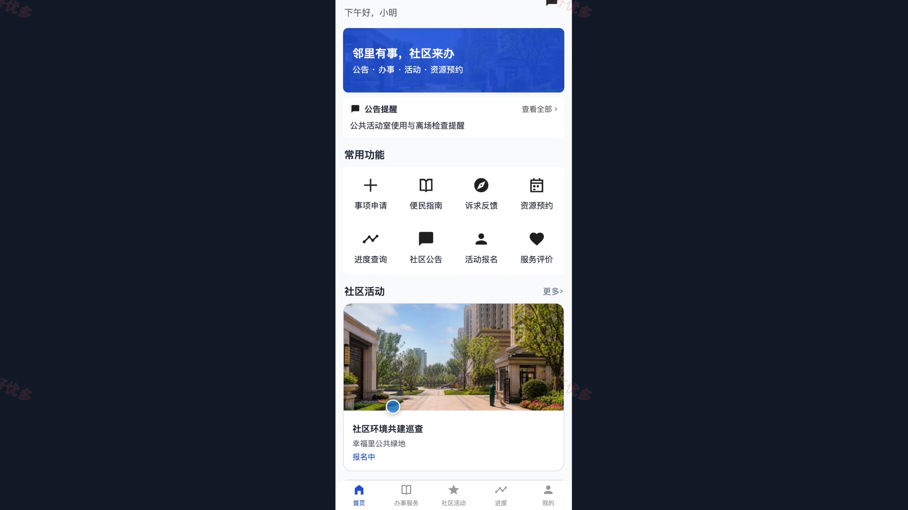
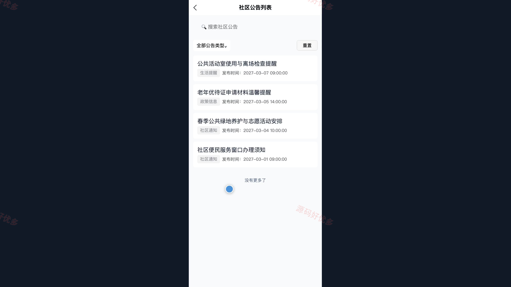
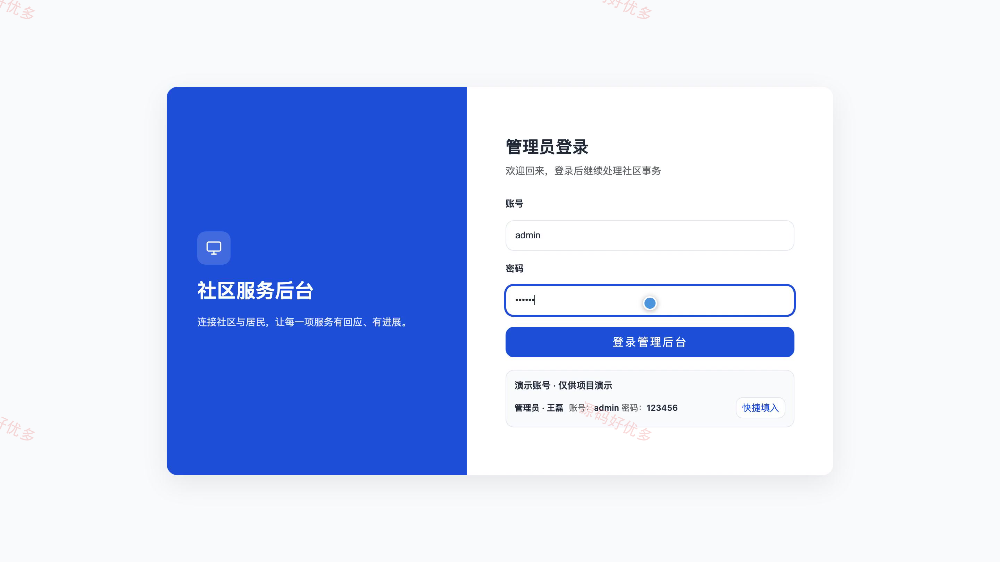
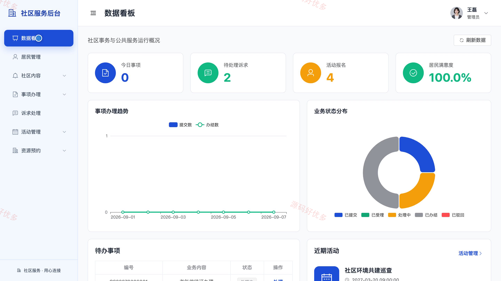
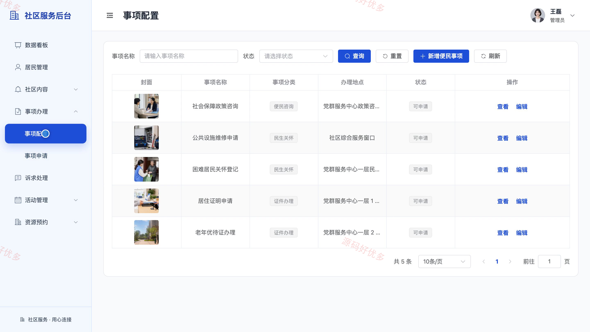

# bs019C
bs019C社区服务微信小程序源码 Java SpringBoot3 Vue3 设计文档 PPT
## 源码问题查看主页咨询

### 一、关键词
社区服务、便民服务、社区活动、公共资源预约、居民诉求

### 二、作品包含
源码+数据库+万字设计文档+PPT+全套环境和工具资源+本地部署教程

### 三、项目技术
前端技术： Html、Css、Js、Vue3.4、Element-Plus、uniapp
后端技术：Java、SpringBoot3.2.0、MyBatis-Plus

### 四、运行环境要求
开发工具：IDEA/eclipse + VSCODE + HBuilder X + 微信开发者工具

数据库：MySQL5.7+（共14张表）

数据库管理工具：Navicat10以上版本

环境配置软件： JDK17 + Maven3.6

前端Nodejs：16+

浏览器：谷歌浏览器

### 五、项目介绍
项目编号：bs019C

本系统面向社区居民与社区工作人员，提供社区公告、便民事项、诉求反馈、社区活动、公共资源预约及进度查询等服务。居民可通过微信小程序查看服务内容并提交申请、报名或预约，管理员通过 PC 后台维护社区资料、处理居民事项和诉求、审核预约并查看业务统计，使社区服务事项形成线上提交、受理和反馈闭环。

角色：居民用户、管理员

居民用户功能：注册登录、社区公告与便民指南、事项申请与进度查询、诉求提交与处理查询、社区活动报名、公共资源预约、服务评价、个人信息与密码维护。

管理员功能：数据看板、居民账号管理、社区资料管理、公告与便民事项配置、居民事项受理与进度处理、居民诉求受理与答复、社区活动及报名管理、公共资源及预约审核。

### 六、运行截图

